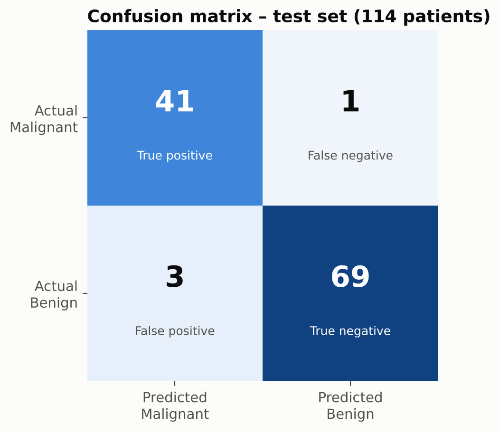
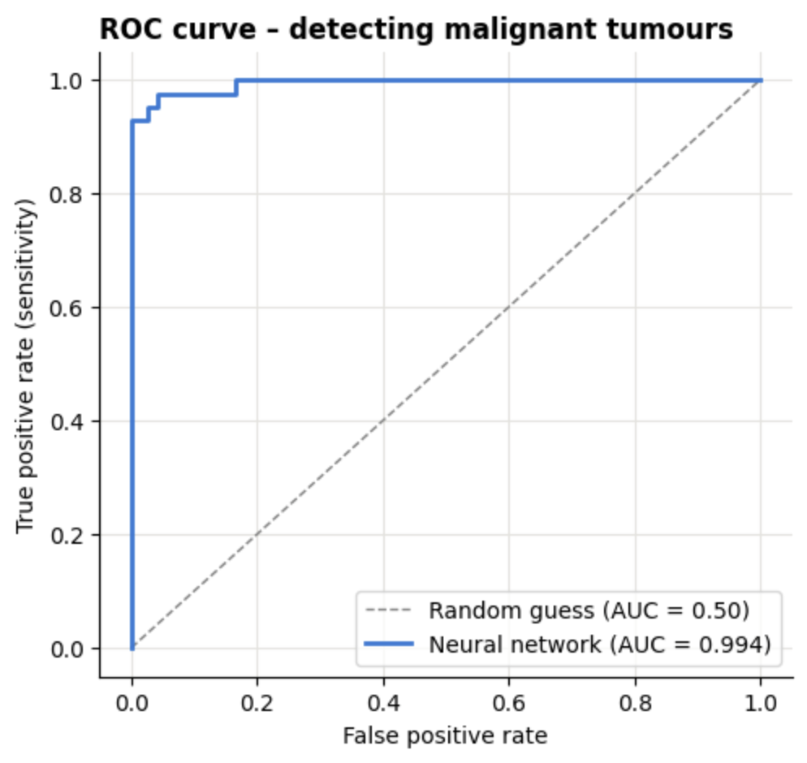
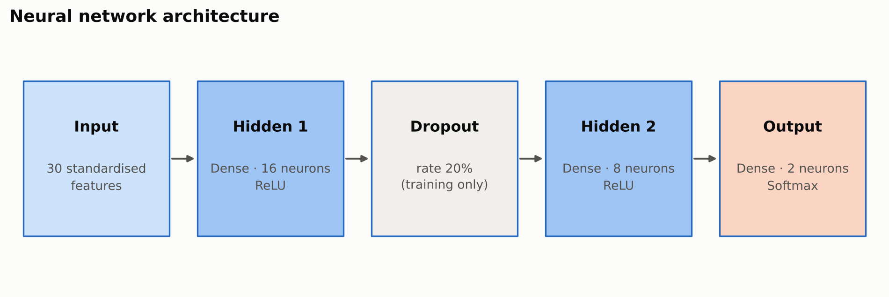
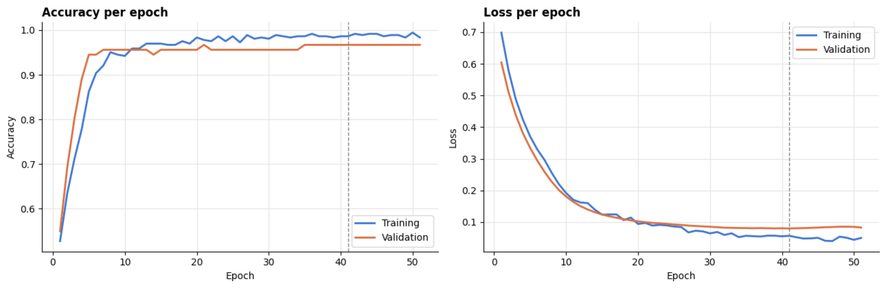
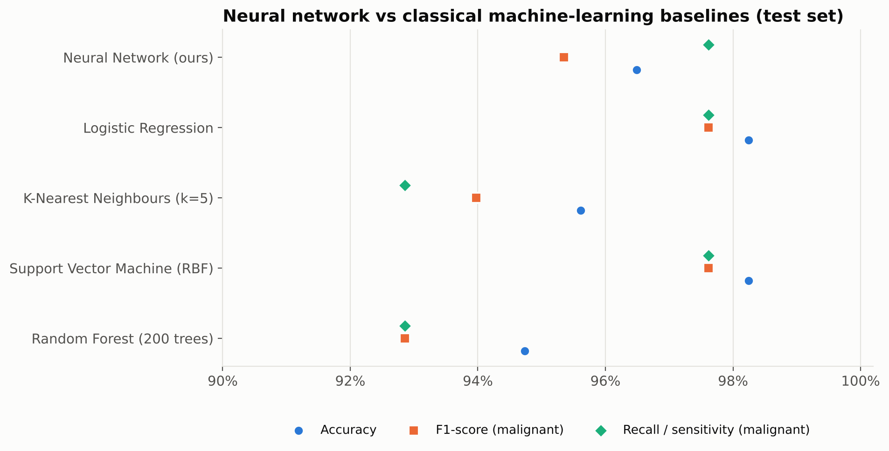
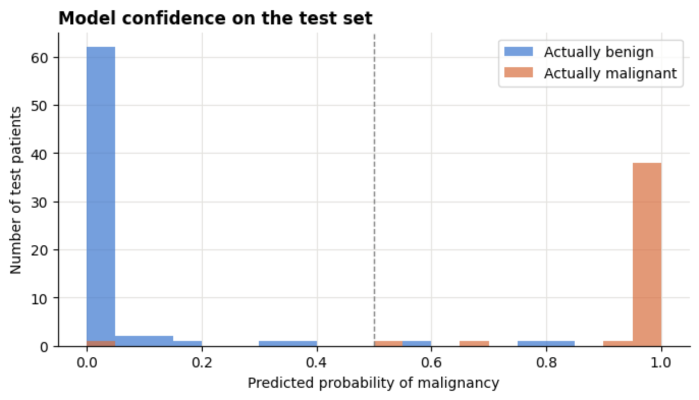

# Breast Cancer Classification using Neural Networks

[](https://www.python.org/)
[](https://www.tensorflow.org/)
[](https://scikit-learn.org/)
[](https://colab.research.google.com/github/sangini-agrawal/breast-cancer-classification-nn/blob/main/notebooks/Breast_Cancer_Classification_NN.ipynb)

A neural network that classifies breast tumours as **Malignant** (cancerous) or **Benign** (non-cancerous) from 30 measurements of cell nuclei, built with **TensorFlow / Keras** on the **Breast Cancer Wisconsin (Diagnostic)** dataset.

> **Internship project** – Naviotech Solution, Artificial Intelligence Domain, September 2026 batch.
> **Author:** Sangini Agrawal

---

## Results

| Metric (test set, 114 patients) | Score |
|---|---|
| **Accuracy** | **96.49 %** (target > 90 %) |
| Recall / sensitivity – malignant | 97.62 % (41 of 42 cancers detected) |
| Precision – malignant | 93.18 % |
| F1-score – malignant | 95.35 % |
| Specificity – benign | 95.83 % |
| ROC-AUC | 0.994 |
| **5-fold cross-validation accuracy** | **97.72 % ± 0.89 %** |

<p align="center">
  
  
</p>

---

## Project structure

```
breast-cancer-classification-nn/
├── notebooks/
│   └── Breast_Cancer_Classification_NN.ipynb   # full walkthrough (run in Google Colab)
├── src/
│   ├── config.py        # paths and hyper-parameters
│   ├── data.py          # loading, cleaning, stratified split, scaling
│   ├── model.py         # neural-network architecture
│   ├── evaluate.py      # metrics and baseline models
│   ├── visualize.py     # all charts
│   ├── train.py         # end-to-end training pipeline
│   └── predict.py       # command-line predictive system
├── models/              # saved model + scaler (created by training)
├── results/
│   ├── figures/         # all charts used in the report and PPT
│   ├── metrics.json     # every metric, hyper-parameter and training history
│   └── classification_report.txt
├── screenshots/         # outputs: dataset, training, accuracy, prediction
├── docs/                # project report, synopsis, presentation
├── requirements.txt
├── LICENSE
└── README.md
```

---

## How to run

### Option A – Google Colab (no installation)
1. Click the **Open in Colab** badge above (or upload `notebooks/Breast_Cancer_Classification_NN.ipynb` to [colab.research.google.com](https://colab.research.google.com)).
2. Choose **Runtime → Run all**. The dataset is built into scikit-learn, so nothing has to be downloaded.

### Option B – Run locally
```bash
git clone https://github.com/sangini-agrawal/breast-cancer-classification-nn.git
cd breast-cancer-classification-nn
python -m venv venv && source venv/bin/activate      # Windows: venv\Scripts\activate
pip install -r requirements.txt

python -m src.train                 # trains, evaluates, saves model + figures (≈ 1 min)
python -m src.predict               # demo prediction
python -m src.predict --values "17.99,10.38,122.8,1001,0.1184,0.2776,0.3001,0.1471,0.2419,0.07871,1.095,0.9053,8.589,153.4,0.006399,0.04904,0.05373,0.01587,0.03003,0.006193,25.38,17.33,184.6,2019,0.1622,0.6656,0.7119,0.2654,0.4601,0.1189"
python -m src.predict --csv new_patients.csv          # one patient per row, 30 columns
```

---

## Dataset

| Property | Value |
|---|---|
| Source | UCI Machine Learning Repository – Breast Cancer Wisconsin (Diagnostic); bundled in scikit-learn |
| Samples | 569 patients – 212 malignant (37.3 %), 357 benign (62.7 %) |
| Features | 30 numeric = 10 nucleus properties × (mean, standard error, worst) |
| Properties | radius, texture, perimeter, area, smoothness, compactness, concavity, concave points, symmetry, fractal dimension |
| Missing values / duplicates | 0 / 0 |

---

## Methodology

| Phase | Work done |
|---|---|
| 1 · Data collection | Load the dataset with `sklearn.datasets.load_breast_cancer` |
| 2 · Data cleaning | Check and remove missing values and duplicates |
| 3 · Preprocessing | Stratified split – **364 train / 91 validation / 114 test**; `StandardScaler` fitted on training data only |
| 4 · Model development | 30 → Dense 16 (ReLU) → Dropout 0.2 → Dense 8 (ReLU) → Dense 2 (Softmax) – 650 parameters |
| 5 · Training | Adam (lr 0.001), sparse categorical cross-entropy, batch 32, up to 100 epochs, early stopping (patience 10) |
| 6 · Evaluation | Accuracy, precision, recall, F1, specificity, ROC-AUC, confusion matrix, 5-fold CV, 4 baseline models |
| 7 · Prediction system | Function + CLI that scale new measurements and return the diagnosis with its probability |

<p align="center"></p>

**Design decisions**
- **Softmax output** (the starter code used sigmoid) – correct pairing with sparse categorical cross-entropy; probabilities sum to 1.
- **Malignant = positive class** – a missed cancer (false negative) is the costliest error, so sensitivity is reported first.
- **Separate validation set + early stopping** – training stops automatically before over-fitting; the test set is used only once.
- **Small architecture on purpose** – I tried a few bigger networks, but they did not score better (all within about 1 %), so I kept the smallest stable one.

---

## Training and evaluation

<p align="center"></p>

Training stopped at epoch 51; the best weights (epoch 41) were restored. Training and validation curves stay close – no over-fitting.

### Comparison with classical machine learning

| Model | Test accuracy | Recall (malignant) | F1 (malignant) | ROC-AUC | 5-fold CV accuracy |
|---|---|---|---|---|---|
| **Neural Network (ours)** | 96.49 % | 97.62 % | 95.35 % | 0.994 | **97.72 % ± 0.89** |
| Logistic Regression | 98.25 % | 97.62 % | 97.62 % | 0.996 | 97.37 % ± 1.66 |
| Support Vector Machine (RBF) | 98.25 % | 97.62 % | 97.62 % | 0.995 | 97.72 % ± 1.63 |
| K-Nearest Neighbours (k=5) | 95.61 % | 92.86 % | 93.98 % | 0.979 | 96.31 % ± 1.79 |
| Random Forest (200 trees) | 94.74 % | 92.86 % | 92.86 % | 0.994 | 95.43 % ± 1.02 |

The neural network ties for the best malignant recall, ties with the SVM for the highest cross-validation accuracy, and is the **most consistent model across folds** (lowest standard deviation). On a small, well-separated dataset like this one, simpler models such as logistic regression do just as well, which was interesting to see.

<p align="center"></p>

---

## Key findings
- Malignant tumours have **larger** nuclei (radius, perimeter, area) and **more concave** boundaries – the strongest signals in the data.
- Only **1 of 42** malignant tumours in the test set was missed; 3 benign tumours were flagged for review (false alarms).
- 104 of 114 test predictions are highly confident (probability < 0.1 or > 0.9) and 103 of those are correct. Three of the 4 errors were borderline (0.57–0.84), but the one missed cancer had a probability of only 0.03 – the model should support, not replace, a specialist.

<p align="center"></p>

## Limitations
- 569 patients from one institution – results may not generalise to other populations or imaging equipment.
- Uses pre-computed nucleus measurements, not raw images.
- An educational model – **not** a medical device.

## Future scope
Larger multi-centre datasets · explainability with SHAP · threshold tuning for even higher sensitivity · CNNs on raw histopathology images · a Streamlit/Flask web app for clinicians.

---

## Tech stack
Python · TensorFlow / Keras · scikit-learn · NumPy · Pandas · Matplotlib · Seaborn · Jupyter / Google Colab

## References
1. W. N. Street, W. H. Wolberg, O. L. Mangasarian, "Nuclear feature extraction for breast tumor diagnosis," *IS&T/SPIE Symposium on Electronic Imaging*, 1993.
2. W. H. Wolberg, W. N. Street, O. L. Mangasarian, *Breast Cancer Wisconsin (Diagnostic)* dataset, UCI Machine Learning Repository, 1995. https://doi.org/10.24432/C5DW2B
3. F. Chollet et al., *Keras*, https://keras.io
4. F. Pedregosa et al., "Scikit-learn: Machine Learning in Python," *JMLR* 12, 2011.

## Acknowledgement
Developed as part of the Artificial Intelligence internship at **Naviotech Solution**.

## License
Released under the [MIT License](LICENSE).
